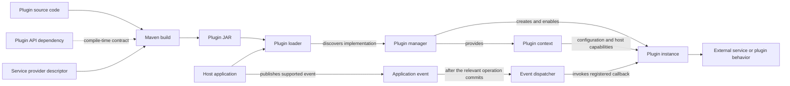

# Plugin Developer Guide

## Changelog

| Version | Date       | Description                                                                     | Status | Authors                             |
|---------|------------|---------------------------------------------------------------------------------|--------|-------------------------------------|
| 0.1     | 2026-10-10 | Initial draft: dependency setup and planned shape of a plugin                   | Draft  | [m000gg](https://github.com/m000gg) |
| 0.2     | 2026-10-13 | Rewrite the guide around the general plugin lifecycle                           | Draft  | [m000gg](https://github.com/m000gg) |


---

## Contents

- [What is a plugin?](#what-is-a-plugin)
- [How plugins work](#how-plugins-work)
- [1. Add the API dependency](#1-add-the-api-dependency)
- [2. Implement the plugin](#2-implement-the-plugin)
- [3. Configure the plugin](#3-configure-the-plugin)
- [4. Register the implementation](#4-register-the-implementation)
- [5. Build the plugin](#5-build-the-plugin)
- [6. Run it with the current host](#6-run-it-with-the-current-host)
- [Available API capabilities](#available-api-capabilities)
- [API compatibility](#api-compatibility)
- [Operational and security guidance](#operational-and-security-guidance)

---

## What is a plugin?

A plugin is an independently built Java JAR that adds an integration or behavior to Unit Billing. Examples include sending notifications or connecting to an external provider.

The host application and a plugin communicate through `unit-billing-plugin-api`. The plugin implements the API's `Plugin` interface. The host loads the JAR, creates the plugin, and gives it a `PluginContext` containing the capabilities currently supported by the API.

A plugin should depend on the API, not on the host application's implementation. This lets the host change its internal packages and persistence code without making those details part of the plugin contract.

See [ADR0009](../adr/0009-multi-module-and-plugins.md) for the architectural decision and alternatives considered.

## How plugins work

There are three parts:

1. **The host application** loads plugins, provides configuration and API capabilities, and manages their lifecycle.
2. **The plugin API** defines the types both sides use to communicate.
3. **The plugin JAR** implements the plugin contract and contains its integration code and any required plugin-owned libraries.



At startup, the host loads a JAR using a `URLClassLoader`. Java's `ServiceLoader` reads the provider descriptor inside the JAR and finds a class implementing `Plugin`. The host gets the plugin's ID, prepares its context, and calls `onEnable`.

During `onEnable`, the plugin can read settings and register callbacks for the event types available in the API. When the host publishes one of those events, it invokes the callbacks registered by enabled plugins. The current event listener runs callbacks after the relevant transaction commits.

When the application shuts down, the host calls `onDisable` and closes the plugin class loader.


## 1. Add the API dependency

Add the API dependency to the plugin module's `pom.xml`:

```xml
<dependency>
    <groupId>com.m000gg</groupId>
    <artifactId>unit-billing-plugin-api</artifactId>
    <version>0.1.0</version>
    <scope>provided</scope>
</dependency>
```

`provided` means the API is available when compiling the plugin but is supplied by the host at runtime. Do not package a second copy of `unit-billing-plugin-api` inside the plugin JAR.

The API is not yet published to a remote Maven repository. To install it locally, run this command from the Unit Billing repository root:

```bash
mvn -pl unit-billing-plugin-api -am install
```

Use the API version compatible with the host application.

## 2. Implement the plugin

Implement `com.m000gg.plugin.api.Plugin`:

```java
package com.example.billingplugin;

import com.m000gg.plugin.api.Plugin;
import com.m000gg.plugin.api.PluginContext;

public final class ExamplePlugin implements Plugin {
    @Override
    public String getId() {
        return "example-plugin";
    }

    @Override
    public void onEnable(PluginContext context) {
        // Read and validate settings.
        // Register callbacks for supported events.
        // Initialize plugin-owned resources.
    }

    @Override
    public void onDisable() {
        // Stop threads and close plugin-owned resources.
    }
}
```

The plugin ID should be stable and unique. The host uses it to find the plugin's settings. Changing the ID may therefore require updating deployment configuration.

`onEnable` is called when the host starts the plugin. Validate configuration and initialize resources there. `onDisable` is the place to stop plugin-owned threads, close connections, and release other resources.

The host currently treats a plugin as loaded if its `onEnable` method returns normally. If a plugin detects invalid configuration and simply returns, the manager does not receive a separate “disabled” or “failed” status. Log configuration problems clearly and do not assume the host can infer them.

## 3. Configure the plugin

The host binds plugin settings under this property prefix:

```properties
unitbilling.plugins.<plugin-id>.<setting-name>=<value>
```

For example, a plugin whose ID is `example-plugin` could read:

```properties
unitbilling.plugins.example-plugin.endpoint=https://service.example
unitbilling.plugins.example-plugin.timeout-ms=3000
```

Settings are exposed as strings through `PluginSettings`. Parse and validate numbers, booleans, and other structured values in the plugin.

Do not commit passwords, access tokens, or private keys to source control. Supply secrets through the deployment's secret configuration mechanism.

## 4. Register the implementation

The host uses Java `ServiceLoader` to discover the implementation class. Add a provider descriptor at this exact path:

```text
src/main/resources/META-INF/services/com.m000gg.plugin.api.Plugin
```

Put the fully qualified name of the implementation class in the file:

```text
com.example.billingplugin.ExamplePlugin
```

The descriptor must be present in the final JAR. If Maven Shade Plugin is used, make sure packaging preserves the service descriptor.

## 5. Build the plugin

The plugin repository uses a multi-module Maven build. Add the plugin's module path to the parent POM's `<modules>` list.

Build all modules from the plugin repository root:

```bash
mvn clean package
```

Build one module and any required reactor modules:

```bash
mvn clean package -pl email-notifier -am
```

The JAR is created under the module's `target/` directory.

Package a plain JAR, not a Spring Boot executable JAR. Include the plugin's required runtime libraries as appropriate, but keep `unit-billing-plugin-api` out of the packaged artifact.

## 6. Run it with the current host

The current host prototype loads one plugin JAR from a path hard-coded in `PluginManager`. To run a plugin with this implementation, the JAR must be placed at the path configured there.

There is no configurable plugin directory yet. Placing a JAR in an arbitrary `plugins/` folder will not make the host discover it. The hard-coded path is a development limitation and should be replaced before this is used as a deployment workflow.

Check the host logs for loading and lifecycle errors. The host calls `onDisable` for the loaded plugin during application shutdown.

## Available API capabilities

The API is the boundary between a plugin and the host. Use only the types it exposes.

### Plugin lifecycle

`Plugin` defines:

- `getId()` — returns the plugin's stable identifier;
- `onEnable(PluginContext)` — initializes the plugin and registers its behavior;
- `onDisable()` — releases resources when the host shuts down.

### Plugin settings

`PluginSettings.get(key)` returns an `Optional<String>`. The plugin is responsible for checking required values and parsing them into the types it needs.

### User contact lookup

`UserDirectory.findContact(userId)` looks up a user by ID and returns an optional `UserContact`. The current `UserContact` contains an email address.

This intentionally exposes a small value type, not the host's user entity or repository.

### Balance-change event

The API currently has one event family: `BalanceChanged`. A plugin can subscribe through `PluginContext.onBalanceChanged(...)`.

The event contains:

- the event and user identifiers;
- a change type: `TOP_UP`, `CHARGE`, `CORRECTION`, or `REFUND`;
- a direction: `INCREASE` or `DECREASE`;
- amount, currency, and resulting balance;
- the transaction time.

The host dispatches this event after the transaction commits. Callbacks currently run synchronously and sequentially. Keep them short, set network timeouts, and handle integration failures inside the plugin. A slow callback may delay event processing.

This is in-process event delivery, not a durable queue. The current implementation does not guarantee retry, persistence, or exactly-once processing.

## API compatibility

The plugin API is a binary contract. Adding an abstract method, removing or renaming a type, changing a method signature, or changing event fields may break plugins compiled against an earlier API.

Prefer backward-compatible additions. A `default` interface method can sometimes provide a safe fallback for older implementations, but it does not make every API change compatible. For an incompatible change, release a new API version and rebuild or migrate affected plugins.

The current host does not check an API compatibility range when it loads a JAR. Keep the plugin dependency aligned with the API version provided by the target host.

## Operational and security guidance

| ✅ Do                                                         | ❌ Don't                                                                         |
|--------------------------------------------------------------|---------------------------------------------------------------------------------|
| Depend on `unit-billing-plugin-api` only.                    | Compile against host entities, repositories, controllers, or services.          |
| Keep the plugin ID stable and use it as the settings prefix. | Change the ID without updating its configuration.                               |
| Validate settings and report actionable errors.              | Assume that the host can detect invalid configuration returned from `onEnable`. |
| Handle external-service failures inside callbacks.           | Let integration errors escape without useful diagnostics.                       |
| Set connection and request timeouts.                         | Perform unbounded blocking work in a callback.                                  |
| Release plugin-owned resources in `onDisable`.               | Leave plugin-created threads or connections running.                            |
| Keep secrets out of source control and logs.                 | Log credentials or unnecessary personal data.                                   |
| Load only trusted plugin JARs.                               | Treat a class loader as a security sandbox.                                     |

Plugins execute inside the host application's JVM and have the process's privileges. A class loader separates classes; it does not prevent plugin code from accessing resources available to the process, such as the file system or network. Only load plugin code you trust.

For a working example, see the `email-notifier` module. For the architectural rationale and known trade-offs, see [ADR0009](../adr/0009-multi-module-and-plugins.md).